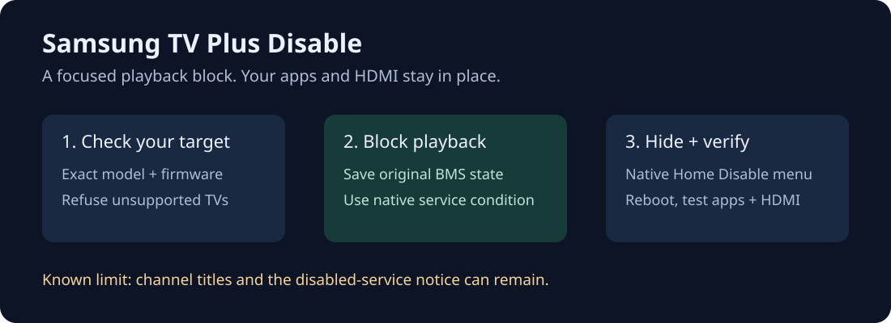

# Samsung TV Plus Disable

**Stop unwanted Samsung TV Plus playback. Keep your streaming apps and HDMI inputs.**

[العربية](docs/README.ar.md) · [Quick start](docs/quickstart.md) · [Recovery](docs/recovery.md) · [Tested results](docs/results.md) · [Download](https://github.com/DadStay/samsung-tvplus-disable/releases/latest) · [Discuss](https://github.com/DadStay/samsung-tvplus-disable/discussions)



An experimental, open-source tool for owners whose Samsung TV falls back to loud
TV Plus playback after leaving an app or turning off a console. It uses an existing
Samsung service condition to block the BMS service, then exits. No computer needs
to stay connected. Hide the Home icon using Samsung's own **Remove → Disable** menu.

**This disables playback; it does not uninstall every TV Plus component.** A black
TV screen can still show a channel title when OK is pressed. The dedicated TV Plus
remote button can still display Samsung's “disabled” notice. Complete UI removal
was tested and **did not succeed**. This is not an ad blocker for other apps.

## Video walkthrough

**I Finally Disabled Samsung TV Plus Using AI** — English narration and captions,
3 min 43 sec, 1080p. The film demonstrates the exact-target setup, guarded commands,
native Disable action and checks. It does not establish support for other TVs or
complete component removal.

[](https://github.com/DadStay/samsung-tvplus-disable/releases/download/v0.1.0/I-Finally-Disabled-Samsung-TV-Plus-Using-AI.mp4)

[Watch/download MP4](https://github.com/DadStay/samsung-tvplus-disable/releases/download/v0.1.0/I-Finally-Disabled-Samsung-TV-Plus-Using-AI.mp4) · [English subtitles](https://github.com/DadStay/samsung-tvplus-disable/releases/download/v0.1.0/Samsung-TV-Plus-English.srt) · [Video details](docs/video.md)

## Compatibility

| Item | Supported target |
| --- | --- |
| Retail model | **UN85DU7200FXZA** |
| System | Tizen 9.0, ARMv7 |
| Exact build | `T-KSU2EDAKUC-0090-REL-202605141700` |
| Live host validation | macOS on Apple silicon, Python 3.12, OpenSSL |
| Status | Experimental v0.1.0; one owner-tested TV |

The tool refuses other models/builds, altered units, symbolic-link backup paths,
and pre-existing block markers. **Do not remove guards to try another Samsung.**
Live TV connectivity on other host platforms has not been validated. Request support through an issue
with the model/build only; no network or account information is needed.

## Get started

1. [Download the release ZIP](https://github.com/DadStay/samsung-tvplus-disable/releases/latest), extract it, and open a terminal in the extracted folder.
2. Follow the [short setup guide](docs/quickstart.md) to enable Developer Mode for your own computer.
3. Run the fixed-target commands below with **your TV's local address**:

```sh
python3 tvplus.py setup
python3 tvplus.py preflight --tv-address <TV_IP>
python3 tvplus.py inspect --tv-address <TV_IP>
python3 tvplus.py disable --tv-address <TV_IP>
```

Replace `<TV_IP>` including the brackets. **`inspect`, `disable`, and `restore`
acquire temporary root on your TV.** Only `preflight` checks HTTP identity without
starting root. The firmware guard runs inside the temporary session before any
BMS change. `setup` downloads a checksum-pinned upstream release and contacts no TV.
No Tizen Studio, Android ADB, pairing token or host .NET SDK is required.

After `disable`, use Home → highlight Samsung TV Plus → hold Select → Remove →
**Disable**. Lower the volume, test YouTube and your console, then reboot and test
again. Close Developer Mode afterward. [Every step, including cleanup](docs/quickstart.md).

## What was actually tested

- On one TV, the BMS block survived a full restart; no TV Plus picture/audio was
  observed, while YouTube and PS5 picture/audio worked.
- Samsung's native Disable action hid the Home icon and recommendations. The icon
  remained hidden in the latest owner report; recommendation persistence was not
  separately reconfirmed in that final report.
- The TV had prior TV Plus app/channel changes. **The two-step public recipe has
  not been tested from a clean factory state.** The BMS block's isolated effect is
  therefore not established. The public transport/inspection path is checked
  separately; see the [validation record](docs/results.md).
- Full live rollback has **not** been tested. The guarded inverse is provided;
  host tests are not proof of recovery on every TV. Firmware updates and factory
  resets may change or remove the mechanism.

## Scope and privacy

The tool creates one protected original-state receipt, creates the existing vendor
marker `/opt/usr/share/systemd/system/bms`, and stops only `bms.service`. It does
not stop the shared TV viewer or slive provider, delete channel databases, change
factory settings, disable firmware updates, patch firmware, or install a persistent
root agent. [How it works](docs/how-it-works.md).

No analytics, account login or cloud service. Normal reports use a fixed allowlist
and omit IP/MAC addresses, serial numbers, tokens and raw device output. The
`host-address` helper intentionally displays your own computer's LAN address locally
so you can enter it on your TV; **do not post that output**. The dependency cache is
local in ignored `.private/`. [Reporting problems privately](SECURITY.md).

## Contribute

Issues, pull requests and Discussions are open. Helpful reports include exact
model/build, whether the block survives reboot, and whether ordinary apps/HDMI
work. Never attach full logs or About TV screenshots. If this helps you, a star
helps other owners find the project. [Contribution guide](CONTRIBUTING.md).

MIT licensed. Inspired by [CleanYourTV](https://github.com/Gathin23/cleanyourtv),
which targets Android TVs. This is an independent Samsung/Tizen project, not its
Samsung port or an official Samsung product. Temporary-root transport comes from
[samsung-tv-root](https://github.com/chris-ritsen/samsung-tv-root) and the direct SDB
client from [AeroTizen](https://github.com/helalaou/AeroTizen); see [notices](NOTICE.md).
