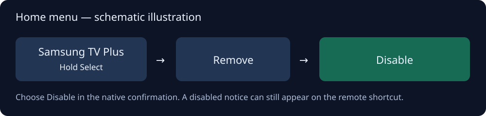

# Quick start

These instructions are for the exact model/build in the main README. All commands
run on your computer, inside this project's extracted folder. They target only
your own TV. A different firmware needs investigation, not a guard override.

## 1. Prepare

- Have Python **3.12+** and OpenSSL on PATH: `python3 --version`, `openssl version`.
- Put your computer and TV on the same trusted LAN. Disconnect VPN routing for
  this test if it prevents local connectivity. Do not forward any router ports.
- Find the TV's IPv4 address on the **TV**: Settings → Connection/Network → Network
  Status → IP Settings. Names vary. A phone's Wi-Fi address is not the TV address.
- Save/finish your game before any restart. Lower the volume for playback tests.

Download the release ZIP from this repository and extract it. Git users can clone
`https://github.com/DadStay/samsung-tvplus-disable.git` instead. Do not run a ZIP
posted by an issue commenter or replace the pinned dependency checksum.

```sh
python3 tvplus.py setup
python3 tvplus.py host-address --tv-address <TV_IP>
```

`setup` retrieves the verified v0.0.12 public root-tool archive. Only its public
Python source, two .NET TV payloads, and license are extracted locally. The archive
label is macOS ARM64; its native host executable is **not run**. The direct Python
SDB adapter is used. Only macOS Apple silicon has host validation so far.

`host-address` prints your computer's LAN address, only to your terminal. Keep it
private; it is for the TV's Host PC IP field. No pairing token is used.

## 2. Enable Developer Mode

On the tested TV: Home → Apps → App Settings, then enter **12345** using the remote's
number pad. In the Developer Mode dialog choose **On**, put the address from the
previous command in **Host PC IP**, then OK. Restart the TV as the dialog requests.
On other menu versions the code is entered on the Apps screen itself; if the
dialog does not appear on this exact target, stop and report the menu difference.

This is a developer dialog, **not a factory/service menu**. No factory menu is used.
Keep the TV on and return to Home after restart.

## 3. Inspect and apply

```sh
python3 tvplus.py preflight --tv-address <TV_IP>
python3 tvplus.py inspect --tv-address <TV_IP>
python3 tvplus.py disable --tv-address <TV_IP>
```

`preflight` contacts the TV's local HTTP identity endpoint and checks the exact
retail model and Developer Mode binding. It does not start root. The build, unit,
directory and original-state guards are checked inside the temporary-root session
before creating the block. Unknown firmware may therefore enter a temporary root
session but will be refused before a BMS write.

`inspect` also obtains temporary root; it reads the BMS state and exits. `disable`
saves a root-owned original receipt under
`/opt/usr/share/samsung-tvplus-disable/original`, verifies it, creates the vendor's
zero-byte block marker, and stops BMS. No always-running host process is needed.

Expect JSON with `success: true`, `staging_cleaned: true`, and
`two_system_file_hashes_unchanged: true`. Those hashes cover `/etc/passwd` and the
SDB public key, **not all TV files**. A successful report does not inspect the TV
screen. On any failure, stop and read [troubleshooting](troubleshooting.md).
Do not repeatedly apply, erase receipts, or manually remove an existing marker.

## 4. Hide the Home icon

On Home, focus Samsung TV Plus, hold Select, choose **Remove**, then **Disable**.
Choose Disable, not only Remove: the native dialog says Disable deletes TV Plus
channels and allows later restoration from Connected Devices.



These are clean schematic illustrations, not screenshots or exact menu artwork.
If Disable is unavailable, stop; do not use factory-menu alternatives. The native
guide is [Samsung's TV Plus support article](https://www.samsung.com/sg/support/tv-audio-video/use-tv-plus-on-your-2025-samsung-smart-tv/);
menus differ by model/software. The tested TV exposed this choice.

## 5. Verify on the real screen

1. Play a YouTube video; confirm picture and sound. Exit it.
2. Turn on the PS5/other HDMI device; confirm picture and sound. Save and turn it off.
3. Navigate Home and press the TV Plus shortcut. Confirm there is no channel audio
   or moving broadcast. A disabled notice or black title-only screen is a known
   remaining interface, not complete UI removal.
4. Restart the TV fully: hold Power until the Samsung logo/restart appears rather
   than only putting it in standby. Menu/remote behavior varies; save work first.
5. Repeat the app/HDMI/TV Plus tests, and run `inspect` once more while Developer
   Mode remains enabled. Report physical results separately from JSON success.

If ordinary apps fail or TV Plus broadcasts again, follow [recovery](recovery.md)
and report the exact model/build and observed behavior. Do not re-run the earlier
channel-deletion or product-feature experiments; they are not part of this recipe.

## 6. Close maintenance access

Open the same Developer Mode dialog, set **Off**, then OK, and restart if requested.
Run `preflight` again: it should refuse the disabled developer binding. This alone
does not prove the SDB port has closed. Verify using your computer's connection
checker, for example on macOS `nc -vz <TV_IP> 26101`; the connection should fail
after the setting takes effect/restart. A timeout can also be a network problem,
so confirm the TV itself is on/reachable and Developer Mode remains Off.

This tool creates no ordinary Wi-Fi remote authorization. If you used another
remote-control program separately, remove only that program's authorization from
the TV's device list, leaving your phone and other devices intact. Do not share
addresses or device lists in public reports.
